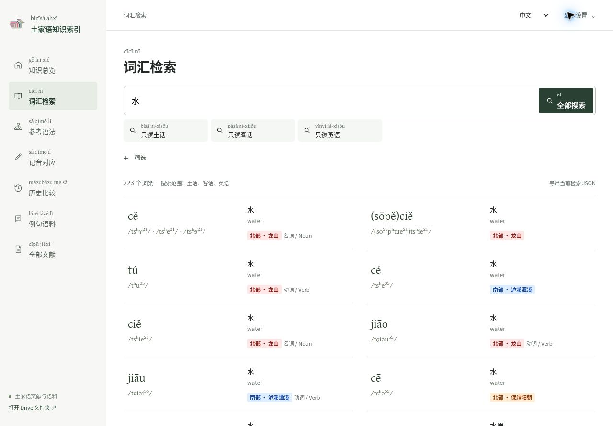

# Responsive dictionary UI and prepared search

The desktop dictionary uses two aligned word lists from 1180px upward, with row order left to right. Phones keep a single list. Opening a desktop word entry leaves the results available beside a 470px detail pane; narrow screens use a full-screen modal. All seven navigation choices remain visible on mobile.

The implementation was rebased onto `edde586` (the nominalization introduction update) after starting from `59aec21`. It retains the reviewed grammar, loanword annotations and hierarchical word classes from that HEAD.

## Data preparation

The build runs normalization, merging, spelling conversion and search indexing once. The browser fetches a 1,750,595-byte compressed search dataset, then loads complete evidence or source texts when needed. A dataset version identifies every related chunk. Native gzip decoding has a bundled, licensed pako fallback.

After the existing dataset expansion, gloss review and IPA normalization steps, run:

```sh
node scripts/prepare-search-data.cjs site
node scripts/test-prepared-search.cjs site
node scripts/test-prepared-loader.cjs site
```

GitHub Pages performs these steps before publishing. Generated records in `site/prepared/` and expanded JSON datasets are ignored by Git. Full Gentium Plus fonts are installed by the existing webfont build step; Charis remains the IPA font.

## Verification on 2026-10-22

| Area | Result |
| --- | --- |
| Automated regression suites | 17 suites passed, including reader copy, search, IPA, southern notation, word merges, word classes and loan reviews |
| Prepared-data equivalence | All 16,577 records; every IPA, displayed spelling, semantic group and loan scope; 40 query/filter combinations and 10 POS groups |
| Original evidence | All word chunks and 54 source-text chunks matched the complete prepared records |
| Reviewed reference grammar | All 13 chapters and 1,553 IPA pairs passed DOM checks for bilingual text, citations, source links and spelling modes |
| Detail rendering | 152 sources, 487 corpus entries and 359 historical comparisons rendered successfully |
| Navigation and export | Shared URLs, aliases, reload, Back/Forward/Close, language/filter persistence and blocked storage passed; JSON export retains evidence and excludes internal caches |
| Responsive browser checks | Seven sections × two languages × five widths (320, 390, 768, 1024, 1440px); no page overflow. Fixed and repeated the 320px English navigation checks |
| Browser interactions | Search and loan/POS filters; desktop and mobile details; grammar chapter, language and spelling switches; readers from all three collections; source full-text search; historical comparison details |
| Gzip compatibility | Native and fallback paths, already-decoded JSON, missing assets and truncated payloads passed |
| Static checks | All runtime JavaScript passed syntax checks; no diff whitespace errors |

QA found and fixed lazy-detail history restoration, narrow English navigation clipping, an English search false positive caused by a source-note parenthesis, and untranslated corpus collection counts.

Browser layout and interaction checks used Chromium with responsive iframe viewports. A physical phone and Safari/WebKit were not available. Local media files absent from the upstream repository remain unavailable; source recording links are retained. External recordings and all third-party source links were not individually playback-tested. The old cleanup-equivalence suite compares a retired layout with a historical commit and does not apply to this redesign. The grammar DOM audit reuses the assertions from the browser grammar suite without requiring a local browser binary.


